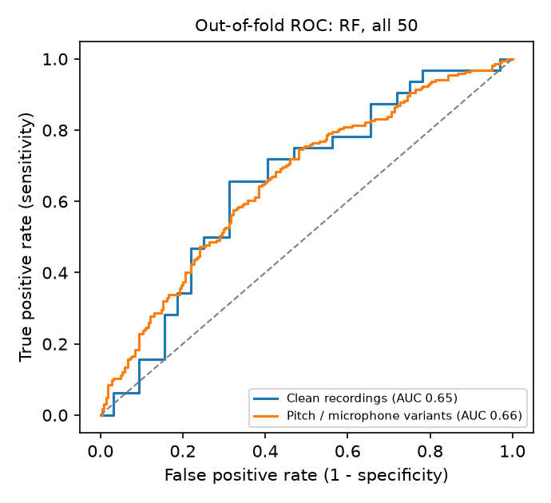

# PD Screening: voice + gait video, combined

One screening page with **two independent models** and a **fusion** that combines them into a single result:

- **Model 1, Voice.** A sustained **"aaah"** is scored for patterns seen in people with Parkinson's disease (PD).
- **Model 2, Gait video.** A video of a person walking is scored from MediaPipe leg keypoints.
- **Fusion.** The two probabilities are put on a common scale and combined with weights that reflect how much each
  model can be trusted (see "How the fusion works"). The combined result is the main focus of the page.

Either model works on its own, and one failing never affects the other. Everything, code, data, models and reports,
lives in this one folder.

> **Screening aid only. Consult a neurologist.** This is a research prototype, not a medical device, and it
> cannot diagnose Parkinson's disease.

## Quick start (Windows, PowerShell)

```powershell
cd C:\PD_Screening
py -3.13 -m venv .venv
.\.venv\Scripts\Activate.ps1
pip install -r requirements.txt
streamlit run app\streamlit_app.py
```

Open http://localhost:8501. The page has three tabs:

**PD Screening** (the main product)
1. *Provide inputs*: **Model 1 · Voice** (record, upload a WAV, or pick a held-out example) and **Model 2 · Gait video**
   (upload a video, choose how many seconds to analyse, click *Analyse video*). The voice result appears as soon as
   there is a recording; the video is analysed when you click the button, with a progress bar.
2. *Your screening result*: the **combined result** (label, score bar with the decision threshold, confidence, and the
   reasons behind it), which is the visual focus.
3. *How each model contributed*: the two individual results side by side (wrapping to one column on a phone), each
   with its probabilities, share of the combined score and key indicators, then an expandable explanation of the fusion
   maths and detail tabs (waveform, Grad-CAM heatmap, feature influence; tracked pose, window scores, gait measurements).

**Voice tools**: *Identify Unknown Voice* (male / female estimate), unchanged and independent of the PD result.

**How it works**: the models, the fusion weights and the audit of the gait model.

The trained models are already in `models/`, so no training is needed to run the app.

Inference API (optional, same models):

```powershell
uvicorn pdscreen.api:app --app-dir src --port 8000
curl.exe -F "file=@recording.wav" http://localhost:8000/predict
```

Retrain everything from the raw data (about 30-40 minutes on a laptop CPU):

```powershell
python scripts\train_all.py
python -m pytest
```

> If Windows shows *"An Application Control policy has blocked this file"* the first time a library loads, run
> the command again. Windows checks newly installed DLLs once.
>
> **pandas may stay blocked.** On this machine Application Control now blocks pandas' compiled libraries, which also
> prevents SHAP from loading. The app does not need pandas: the models load and run on numpy and scikit-learn,
> feature influence is explained by occlusion when SHAP is unavailable, and tables use plain markdown. The saved voice
> model was migrated once with `scripts\migrate_bundle_to_numpy.py` (original kept as `feature_model.joblib.bak`) because
> it had been saved containing a pandas table. The training scripts still use pandas and need it unblocked.

Model 2 needs MediaPipe and OpenCV (`pip install -r requirements.txt`) and the files in `models\gait\`: the two random
forests, the audit summary and `pose_landmarker_full.task` (MediaPipe pose model, from
https://storage.googleapis.com/mediapipe-models/pose_landmarker/pose_landmarker_full/float16/latest/pose_landmarker_full.task).
The gait-video model was trained in the separate `C:\PD_Gait` project, which holds its training code and audit.

## Results (read this before trusting a score)

All numbers are person-level and come from people the model was not trained on; the full report with every
table is in [`reports/results.md`](reports/results.md).

**Why the first version gave "PD" for healthy people.** It memorised its training people (training AUC 1.0) and
separated unseen people poorly: on the 17 held-out people it flagged 56% of healthy people as PD even on clean
dataset audio, and 59% with a simulated laptop microphone. Dataset recordings it had trained on looked correct,
which hid this. It also leaned on MFCC standard deviations (a recording-channel signature) and on absolute pitch.

**What changed.** Features from fixed 1.5 s windows (median over windows); training on pitch-shifted (formants
preserved) and microphone-simulated copies of every training person; model, feature set and decision threshold
chosen on out-of-fold people, including their perturbed audio.

| Held-out people (17), through the app code path | Healthy people cleared | People with PD flagged |
|---|---|---|
| First version, clean audio | 44% | 75% |
| First version, simulated laptop microphone | 41% | 62% |
| **Current, clean audio** | **78%** | 50% |
| **Current, simulated laptop microphone** | **81%** | 42% |
| **Current, pitch changed up or down** | **72%** | 50% |

Cross-validation on the 64 development people (deployed model, threshold 0.62): AUC 0.65 on clean audio and 0.66
on perturbed audio, specificity about 0.81 and **sensitivity about 0.34**. On the 17 test people AUC is 0.65
(95% CI 0.35-0.91). **In plain terms: the model now rarely calls a healthy voice PD, and in exchange it misses
about half to two thirds of people with PD. A "Healthy" result does not rule out Parkinson's.**

The honest conclusion is that 81 telephone recordings, with healthy people much younger than PD patients
(mean age 48 vs 67; an age-only model reaches AUC 0.85), are not enough to build a dependable voice screener.
Removing the channel-sensitive MFCC features drops every model to chance. What would help most: more people
(the Italian dataset adds 65), ideally age-matched, and recordings made on the devices the tool will be used on.
Do not add live recordings of healthy people to the training set without matching PD recordings from the same
devices; the model would learn to tell the microphone apart instead of the disease.



## How the fusion works

```text
voice recording -> Model 1 (voice) ----                                        >-> align to a common scale -> weight by trust -> combined score -> result
walking video ---> Model 2 (gait) -----/        (own thresholds -> 50%)   (credited AUC - 0.5)   (50% = decision line)
```

1. **Align.** Each model has its own decision threshold (voice 0.62, gait 0.50). Each probability is shifted in log-odds
   so its own threshold sits at 50%.
2. **Weight.** A model's weight is `max(credited AUC - 0.5, 0.01)`. The credited AUC is the validated, person-wise AUC, but
   for the gait model only what it reaches **beyond a model that sees no gait at all**.
3. **Combine.** Weighted average of the aligned probabilities; at least 50% means *PD likely*.
4. **Confidence.** From the distance to 50%. Two informative models that agree raise it one level, two that disagree lower
   it, and a single model is capped at *Moderate*.
5. **Safeguards.** A model without input, or one that failed, is simply absent. For each uploaded video a camera-framing-only
   model is also run; if it reaches the same verdict, the gait result is left out of the combined score. With only the
   gait model the result is *Inconclusive*.

Current weights: voice credited AUC 0.65 (weight 0.15); gait credited AUC 0.50 (weight 0.01, about 6% of a combined
score). **Why so low for gait:** its AUC on held-out people is 1.00, but so is the AUC of models given only the video's
frame rate and size, or only camera framing, because its Parkinson's videos and normal videos were filmed with
different cameras, framings and tasks. Its accuracy therefore cannot be credited to Parkinson's. The combination has
not been validated on anyone who has both a voice recording and a gait video. Code: `src/pdscreen/fusion.py`
(`tests/test_fusion.py`).

## Identify Unknown Voice (male / female)

An average of two calibrated logistic regressions on the same cleaned 1.5 s windows: one sees pitch only, the other
pitch plus 13 MFCC means. Averaging means a confident answer needs both to agree, which keeps unfamiliar audio
(a different microphone, a synthetic tone) from producing a confident wrong answer. Scores between 35% and 65%
female are reported as "Uncertain". Trained on the 64 development people of the figshare set (44 women and 37 men
in total; sex labels come from its demographics sheet) and evaluated person-wise, like the screening model.

| | Accuracy (all calls) | Accuracy when it commits | Called "Uncertain" |
|---|---|---|---|
| Cross-validation, clean audio (64 people) | 89% | 93% | 23% |
| Cross-validation, simulated microphone | 86% | - | - |
| Held-out test, clean audio (17 people) | 94% (95% CI 82-100%) | 100% | 24% |

On the 17 held-out recordings, all 13 confident calls were correct. This describes how a voice *sounds* (pitch and
tone), not anyone's gender identity. It was trained on adult sustained "aaah" recordings only; children, voice
disorders, whispering, and unusually high or low voices can be misjudged. Men with PD in this data often have a
raised pitch, which is the main source of errors.

## Data

| Dataset | Used for | People | Recordings | Access |
|---|---|---|---|---|
| **Iyer et al. 2023**, *Voice Samples for Patients with Parkinson's Disease and Healthy Controls* ([figshare](https://doi.org/10.6084/m9.figshare.23849127), CC BY 4.0) | Training, cross-validation and test of the deployed models | 40 PD, 41 healthy | 81 sustained /a/, telephone, 8 kHz, 1.5-7.2 s | Open download |
| **UCI Parkinson's**, Little et al. 2007 ([UCI 174](https://archive.ics.uci.edu/dataset/174/parkinsons)) | Leakage demonstration: split by recording vs by person | 24 PD, 8 healthy | 195 (6-7 per person), features only | Open download |
| Italian Parkinson's Voice and Speech (IEEE DataPort) | Not used yet: needs a free IEEE login. Drop the zip in `data/raw/` to add it as an external test set | 28 PD, 37 healthy | Sustained vowels and speech | Free account |
| PC-GITA | Not used: access by request to the authors | 50 PD, 50 healthy | Spanish speech | On request |

**Class balance.** The training dataset is balanced (40 vs 41). Class weights are still applied inside every
training fold, using that fold's counts only.

**Why not the old `Voice_DataSet.zip`?** Its 2,268 clips (1,148 healthy, 1,120 PD) are the same 81 people as the
figshare set, each copied about 28 times with small changes (41 x 28 = 1,148; 40 x 28 = 1,120; the healthy clips
match the original recordings with correlation 1.0). Splitting those clips randomly puts copies of one person in
both training and test, which is why earlier results looked better than they were. This project uses the 81
original recordings and splits by person.

**Known limitations of the data**
- **Small**: 81 people. Every metric has a wide confidence interval (reported below).
- **Age imbalance**: the healthy group averages 48 years (23 of 41 under 50); the PD group averages 67 (3 of 40
  under 50). A model can partly learn "older voice" rather than "Parkinson's voice". An age-only baseline and a
  50+ subgroup analysis are reported to measure this.
- **One recording per person**, over the telephone, so the training audio is band-limited (about 300-3,400 Hz).
  Live microphone audio is filtered to the same band, but a device gap remains.
- No information on disease stage, medication state or other voice disorders.

## Method

```
microphone (5-10 s) -> resample to 8 kHz -> band-pass 80-3,400 Hz -> spectral-gating denoise -> trim silence
   -> up to 8 windows of 1.5 s (equal loudness) -> 50 features per window (Parselmouth + librosa)
   -> calibrated Random Forest per window -> median over windows -> P(PD) vs threshold 0.62 -> label

   same cleaned audio -> 1 s log-Mel windows -> CNN (ONNX) -> Grad-CAM heatmap and a second-opinion score
                                                (explanation aid; not part of the final label)
```

The same preprocessing function runs during training and in the app, so live audio reaches the models in the
same form as the training data.

**Features (50)**: pitch (mean, variation in semitones, min, max, range, voiced fraction); jitter (local,
absolute, RAP, PPQ5, DDP) and shimmer (local, dB, APQ3, APQ5, APQ11, DDA) from Praat via Parselmouth; HNR and
NHR; PPE, RPDE and DFA (re-implemented from Little et al. 2007/2009); spectral centroid and flatness; 13 MFCC
means and standard deviations. A smaller "clinical" set (24 features, no MFCCs) is also evaluated.

**Baselines**: logistic regression, SVM (RBF), Random Forest and XGBoost. Each one is
impute -> scale -> classifier, tuned with a small grid in inner cross-validation, then sigmoid-calibrated.

**Deep learning**: a 4-block CNN (60,641 weights) on 64-band log-Mel windows of 1 s (50% overlap). The training
recipe:
- Up to 100 epochs, AdamW, cosine learning-rate schedule.
- Early stopping on validation loss (patience 15, minimum 10 epochs), because the person-level validation AUC
  of 10-13 people is too noisy to stop on.
- Platt calibration of its output, fitted on out-of-fold predictions.
- Class-weighted loss.
- Augmentation on the training fold only: pitch shift of ±0.5 and ±1 semitone, added noise at 15-40 dB SNR, and
  SpecAugment.

The trained network is exported to ONNX and run with ONNX Runtime. Transfer learning (wav2vec2 or YAMNet) was not
used. With 64 training people the small CNN is the more defensible choice; wav2vec2 is a natural next step if a
larger dataset (Italian, PC-GITA) is added.

**Evaluation**:
- **Split by person**: 17 people (stratified by group and age band) are held out before any modelling.
- On the 64 development people: repeated, stratified, person-grouped 5-fold cross-validation (`StratifiedGroupKFold`).
  Tuning and early stopping use only the training part of each fold.
- The deployed model is chosen on cross-validation results alone. The test set is evaluated once.
- Metrics: accuracy, precision, sensitivity, specificity, F1, ROC-AUC, confusion matrix, Brier score and
  calibration curves. The test set also gets bootstrap 95% intervals.
- Explainability: SHAP (on the calibrated probability) for the feature model and Grad-CAM for the CNN, both in the
  report and live in the app.

**Real-time path**: feature extraction takes about 0.1 s and the CNN takes milliseconds. End-to-end latency for
10 s of audio is checked to be under 2 s by an automated test. The app warms the libraries up once at start-up.

## Repository layout

```
app/streamlit_app.py        the PD Screening page (inputs -> both models -> fusion -> result)
app/views.py                styles, hero card, model cards, detail views
app/tools.py                Identify Unknown Voice and the shared source picker
src/pdscreen/
  audio.py                  loading, validation, the shared preprocessing chain, 1.5 s analysis windows
  augment.py                pitch change (formants kept) and laptop-microphone simulation
  features.py               Parselmouth/librosa features, PPE, RPDE, DFA
  datasets.py               manifests with subject IDs, person-wise hold-out split
  models_classic.py         LR / SVM / RF / XGBoost, nested grouped CV, calibration
  cnn.py                    log-Mel front end, CNN, augmentation, training loop, ONNX export
  evaluation.py             metrics, bootstrap CIs, calibration, plots
  explain.py                SHAP and Grad-CAM
  inference.py              Screener: bytes -> result (used by the app and the API)
  voice_id.py               VoiceIdentifier: bytes -> male/female estimate (Voice tools tab)
  fusion.py                 reliability-weighted fusion of Model 1 and Model 2
  compat.py                 detects blocked pandas / SHAP and lets the app degrade gracefully
  gait/                     Model 2: pose.py (MediaPipe), motion.py (gait features), inference.py (GaitScreener)
  api.py                    FastAPI service (/predict, /health)
scripts/                    prepare_data, train_classic, train_cnn, evaluate_uci, prepare_windows,
                            baseline_robustness, train_robust (screening model), train_voice_id (male/female),
                            finalize, benchmark_latency, train_all
models/                     feature_model.joblib, mel_cnn.onnx (+ .pt), deployment.json, gait/
reports/                    results.md, JSON metrics, out-of-fold and test predictions, figures/
tests/                      audio, features, person-wise splits, inference latency, ONNX parity, API, fusion,
                            gait video
docs/DEMO.md                script for the demo video
```

## Limitations

- Trained and tested on 81 people from one dataset; there is no external validation yet. Treat the numbers as an
  early estimate, not as the expected performance on the public.
- The age imbalance in the data inflates every voice model to some degree (see the age check above).
- Telephone training audio vs live microphones: the band-pass filter narrows the gap but does not close it. A
  noisy room, a very short "aaah" or an unusual voice lowers the reported confidence.
- PPE, RPDE and DFA are re-implementations, so their values are not directly comparable to the UCI dataset's.
- Not a diagnosis. **Screening aid only. Consult a neurologist.**

## References

- Iyer A. et al. (2023). A machine learning method to process voice samples for identification of Parkinson's
  disease. *Scientific Reports* 13, 20615.
- Little M.A. et al. (2007). Exploiting nonlinear recurrence and fractal scaling properties for voice disorder
  detection. *BioMedical Engineering OnLine* 6:23.
- Little M.A. et al. (2009). Suitability of dysphonia measurements for telemonitoring of Parkinson's disease.
  *IEEE Trans. Biomed. Eng.* 56(4).
- Jadoul Y., Thompson B., de Boer B. (2018). Introducing Parselmouth: A Python interface to Praat. *J. Phonetics* 71.
